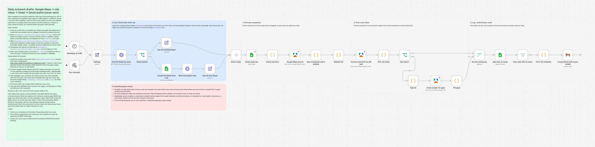

# Daily outreach drafts from Google Maps (n8n)

Every weekday morning this workflow finds new local businesses for one of your searches (for example "event agency in Manchester"), finds the inbox each business publishes on its own website, logs the company in a Google Sheet and leaves one Gmail **draft** per company. It never sends an email: you read the drafts and press send yourself.

## How it works

1. Finds (or on the first run creates) your Google Sheet and reads the Leads tab so known companies are skipped (matched by website domain).
2. [google-maps-scraper](https://apify.com/santamaria-automations/google-maps-scraper?fpr=0khfbz&fp_sid=gh-daily-outreach-drafts-google-maps) returns 20 places for today's search and city pair.
3. [website-contact-extractor](https://apify.com/santamaria-automations/website-contact-extractor?fpr=0khfbz&fp_sid=gh-daily-outreach-drafts-google-maps) reads each website's contact pages and a role inbox (info@, hello@, events@) is picked. Personal addresses are never used.
4. Companies still without an inbox go to [website-email-scraper](https://apify.com/santamaria-automations/website-email-scraper?fpr=0khfbz&fp_sid=gh-daily-outreach-drafts-google-maps).
5. Every new company gets a row; companies with an inbox also get a Gmail draft built from your template.

## Requirements

- [n8n](https://n8n.partnerlinks.io/rx97o1phofve) (Cloud or self-hosted) with the verified community node `@apify/n8n-nodes-apify`
- An Apify account ([free sign-up](https://console.apify.com/sign-up?fpr=0khfbz&fp_sid=gh-daily-outreach-drafts-google-maps))
- A Google account (Google Sheets and Gmail)

## How to import

1. Open [n8n](https://n8n.partnerlinks.io/rx97o1phofve) ([n8n Cloud](https://n8n.partnerlinks.io/rx97o1phofve) or self-hosted) and create a new workflow.
2. Use the menu (three dots) > **Import from file** and choose `workflow.json` from this folder.
3. Install the verified community node `@apify/n8n-nodes-apify` (Settings > Community nodes) if n8n asks for it.
4. Create your credentials: an [Apify account](https://console.apify.com/sign-up?fpr=0khfbz&fp_sid=gh-daily-outreach-drafts-google-maps) (free sign-up) for the Apify nodes, plus the other services listed under Requirements.
5. Open the **Settings** node, fill in your values, run once with **Test workflow**, then activate.

## Customization

- Searches and cities (one per line; each weekday uses the next pair), new companies per day, sender name, subject and body in the **Settings** node.
- Placeholders `{company}`, `{category}`, `{city}`, `{sender}` are filled in per company.
- Every Apify node has a **Max cost per run** cap.

## Cost

About 0.15 to 0.20 USD a day for 10 new companies at Apify Store prices (checked 2026-11-16): Maps 0.001 USD per place, contact extractor 0.01 USD per website with contacts, email scraper 0.001 USD per page. The Maps search runs every day even when it finds nothing new (about 0.02 USD).

## Notes

Tested on n8n 2.35.7 and 2.47.7 (2026-11-16). Drafts are a template, not AI-written. Check your local rules for B2B email (for example GDPR/PECR) before sending.

## Contact

contact@nanoscrape.com

---

Links to apify.com and n8n contain our affiliate IDs. Prices are unchanged for you.
