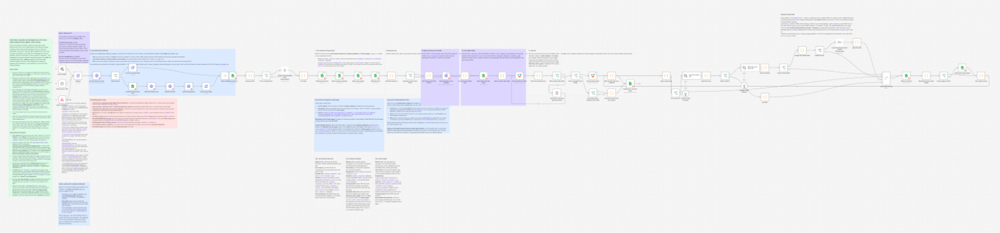

# Job matches and cover letters (n8n)

A job-search tracker in Google Sheets. List your searches in three tabs (job boards with keywords, company websites, career pages). Every morning the workflow collects new jobs from all of them, removes duplicates across boards, scores each new job against your CV with your own AI model and drafts a cover letter for good matches in the language you choose. Nothing is applied for or sent. Every job is a row with a status dropdown that you move forward yourself.

## How it works

1. Add your CV as text (or a Google Doc link) in the **Settings** node. Without a CV the run stops before any Apify cost.
2. On the first run the workflow creates your Google Sheet with five tabs (Jobs, three input tabs with example rows, Runs).
3. [job-feed](https://apify.com/santamaria-automations/job-feed?fpr=0khfbz&fp_sid=gh-job-matches-cover-letters) runs your searches and returns only jobs it has not delivered before.
4. Your AI model gives each new job a 0-100 score and a two-line reason.
5. Jobs at or above your minimum score that have a description get a cover letter draft that uses only facts from your CV. Optional Gmail drafts (off by default, never sent).

## Requirements

- [n8n](https://n8n.partnerlinks.io/rx97o1phofve) (Cloud or self-hosted) with the verified community node `@apify/n8n-nodes-apify`
- An Apify account ([free sign-up](https://console.apify.com/sign-up?fpr=0khfbz&fp_sid=gh-job-matches-cover-letters))
- A Google account (Sheets; optional Docs for the CV and Gmail for drafts)
- An AI model credential: OpenAI by default; OpenRouter, Anthropic or Gemini work as drop-in swaps
- Your CV as plain text or a Google Doc

## How to import

1. Open [n8n](https://n8n.partnerlinks.io/rx97o1phofve) ([n8n Cloud](https://n8n.partnerlinks.io/rx97o1phofve) or self-hosted) and create a new workflow.
2. Use the menu (three dots) > **Import from file** and choose `workflow.json` from this folder.
3. Install the verified community node `@apify/n8n-nodes-apify` (Settings > Community nodes) if n8n asks for it.
4. Create your credentials: an [Apify account](https://console.apify.com/sign-up?fpr=0khfbz&fp_sid=gh-job-matches-cover-letters) (free sign-up) for the Apify nodes, plus the other services listed under Requirements.
5. Open the **Settings** node, fill in your values, run once with **Test workflow**, then activate.

## Customization

- Letter language, length and tone: `language`, `letterWords`, `letterStyle`.
- Which jobs get a letter: `minScore`.
- Volume and cost: `postedWithinDays`, `maxJobsPerRun`, `maxJobsPerCompany`, `maxCostPerRunUsd`.
- Optional: Gmail drafts (`createGmailDrafts`), contact and company columns, a webhook for instant results.

## Cost

About 0.004 USD per job delivered from job boards at Apify Store prices (checked 2026-11-16); career pages about 0.001 USD per job; company websites about 0.012 USD per job plus 0.01 USD per company. Plus your AI provider's usage.

## Notes

Tested on n8n 2.35.7 (2026-11-18). Two optional nodes (Read CV from Google Docs, Create Gmail draft) ship disabled so the workflow can be activated without those credentials; enable one and connect its credential only when you use it. Your CV text is sent to the AI provider you connect.

## Contact

contact@nanoscrape.com

---

Links to apify.com and n8n contain our affiliate IDs. Prices are unchanged for you.
