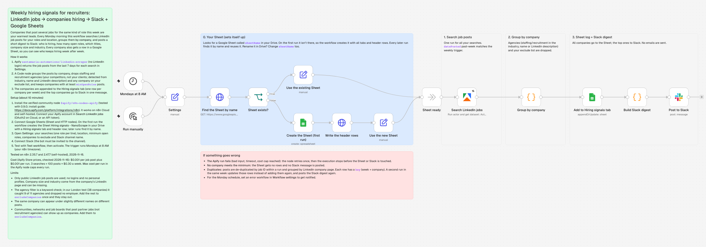

# Weekly hiring signals for recruiters (n8n)

Companies that post several jobs for the same kind of role this week are warm leads. Every Monday this workflow searches LinkedIn job posts for your roles and location, groups them by company, drops staffing agencies, and posts a short digest to Slack. Every company also gets a row in a Google Sheet so you can see who keeps hiring.

## How it works

1. [linkedin-scraper](https://apify.com/santamaria-automations/linkedin-scraper?fpr=0khfbz&fp_sid=gh-weekly-hiring-signals) (no LinkedIn login) returns job posts from the last 7 days for each search.
2. A Code node groups posts by company, drops agencies and your exclude list, and keeps companies with at least `minOpenRoles` posts.
3. Companies are written to the Hiring signals tab (a second run in the same week updates the same rows) and the top companies go to Slack.

## Requirements

- [n8n](https://n8n.partnerlinks.io/rx97o1phofve) (Cloud or self-hosted) with the verified community node `@apify/n8n-nodes-apify`
- An Apify account ([free sign-up](https://console.apify.com/sign-up?fpr=0khfbz&fp_sid=gh-weekly-hiring-signals))
- A Google account (Sheets)
- A Slack workspace (the bot must be invited to the channel)

## How to import

1. Open [n8n](https://n8n.partnerlinks.io/rx97o1phofve) ([n8n Cloud](https://n8n.partnerlinks.io/rx97o1phofve) or self-hosted) and create a new workflow.
2. Use the menu (three dots) > **Import from file** and choose `workflow.json` from this folder.
3. Install the verified community node `@apify/n8n-nodes-apify` (Settings > Community nodes) if n8n asks for it.
4. Create your credentials: an [Apify account](https://console.apify.com/sign-up?fpr=0khfbz&fp_sid=gh-weekly-hiring-signals) (free sign-up) for the Apify nodes, plus the other services listed under Requirements.
5. Open the **Settings** node, fill in your values, run once with **Test workflow**, then activate.

## Customization

- Searches (one role per line), location, minimum open roles, excluded companies and Slack channel in the **Settings** node.
- Add agencies the keyword filter missed to `excludeCompanies`.

## Cost

About 0.001 USD per job post plus 0.001 USD per run at Apify Store prices (checked 2026-11-16). 3 searches x 100 posts is about 0.30 USD a week.

## Notes

Tested on n8n 2.35.7 and 2.47.7; the Slack post was tested with a no-op node (no Slack workspace connected). Only public LinkedIn job posts are used. The agency filter is a keyword check, so some agencies can slip through.

## Contact

contact@nanoscrape.com

---

Links to apify.com and n8n contain our affiliate IDs. Prices are unchanged for you.
